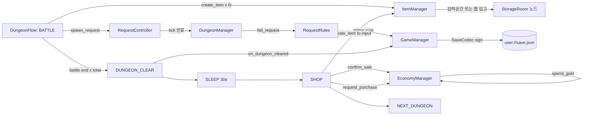
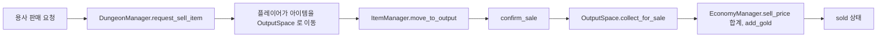
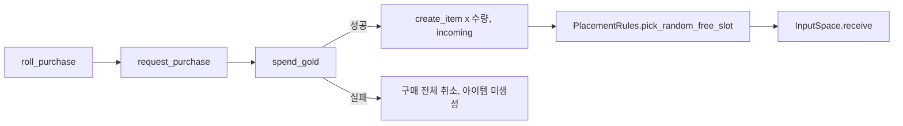

# 컴포넌트 의존성 (Component Dependency)

## 1. 의존성 매트릭스

행(호출하는 쪽) → 열(호출받는 쪽). `O` = 메서드 호출, `S` = 시그널 구독 (AD-4), `-` = 없음.

| 호출 \ 대상 | GameManager | DungeonManager | ItemManager | EconomyManager | 순수 클래스 | 씬 노드 |
| --- | --- | --- | --- | --- | --- | --- |
| **GameManager** | - | S (던전 완료, 게임오버) | - | - | SaveCodec (O) | SaveTransferPanel (S) |
| **DungeonManager** | O (저장 요청, 실패 누적) | - | O (입고, 판매 이동) | O (구매 차감, 판매 · 보상) | RequestRules, PurchaseRoller (O) | BattleView, SleepOverlay, ShopView, RequestPanel (S) |
| **ItemManager** | - | S (수납 완료 알림) | - | O (EXP 지급 요청) | WeightRules, PlacementRules (O) | Item, StorageFacility, InputSpace, OutputSpace, ItemListPanel (S) |
| **EconomyManager** | O (레벨업 화면 요청) | - | O (판매 대상 가격 조회 시 ItemData 만 사용) | - | GoldLedger, ExpCalculator, AugmentPool, PurchaseRoller (O) | HUD (S) |
| **Player 씬** | - | - | O (줍기, 드롭) | - | - | - |
| **Main 씬** | O (화면 전환 수신) | - | - | - | - | 모든 화면 노드 조립 |

**규칙**
- 오토로드끼리는 직접 호출을 최소화하고, 필요한 경우 시그널을 사용한다 (AD-4).
- 골드 증감은 `EconomyManager` 메서드만 허용한다 (NFR-04). 다른 곳에서 `gold` 를 직접 쓰지 않는다.
- 순수 클래스는 다른 오토로드나 노드를 참조하지 않는다 (PBT 가능, AD-3).

## 2. 시그널 흐름 (발신 → 수신)

| 발신 | 시그널 | 수신 | 용도 |
| --- | --- | --- | --- |
| DungeonManager | `battle_items_arrived` | ItemListPanel, HUD | 전투마다 입고 연출 및 목록 갱신 |
| DungeonManager | `dungeon_cleared` | GameManager | 자동 저장 트리거 (FR-25) |
| DungeonManager | `sleep_started` / `sleep_finished` | SleepOverlay | 30초 수면 연출 (FR-14) |
| DungeonManager | `shop_opened` / `shop_closed` | ShopView, Main | 상점 화면 전환 |
| DungeonManager | `request_started` / `request_result` | RequestPanel, HUD | 요청 표시, 결과 표시 |
| GameManager | `game_over` | GameOverScreen, Main | 누적 실패 3회 (FR-21) |
| ItemManager | `item_dropped` | StorageRoom (아이템 표시) | 무게 초과 낙하 (FR-07) |
| ItemManager | `weight_rejected` | HUD (메시지) | "무게 초과" 메시지 (D-09) |
| ItemManager | `item_state_changed` | ItemListPanel, DungeonManager | 상태 변화 반영 |
| EconomyManager | `gold_changed` | HUD | 공유 골드 표시 (FR-19) |
| EconomyManager | `level_up` | AugmentSelection, Main | 증강 선택 화면 (FR-11) |

## 3. 데이터 흐름 (주요 시나리오)

### 3-1. 던전 1개 진행

### 3-2. 상점 판매

### 3-3. 상점 구매

## 4. 결합도 점검

| 항목 | 상태 | 근거 |
| --- | --- | --- |
| 순환 의존 | 없음 | DungeonManager ↔ ItemManager 는 메서드 호출 방향이 한쪽 (Dungeon → Item) 으로 정해짐. 역방향은 시그널 |
| 골드 단일 원본 | 확보 | `GoldLedger` 를 EconomyManager 가 소유 (NFR-04) |
| 순수 로직 분리 | 확보 | 8개 순수 클래스, 씬 · 오토로드 참조 없음 (AD-3, NFR-09 대상) |
| 저장 경계 | 확보 | 저장 대상은 스냅샷 Dictionary 로 한정, 노드 직접 직렬화 없음 |
| 상점 · 던전 결합 | 주의 | ShopFlow 가 DungeonFlow 의 SHOP 상태 안에서만 동작하도록 상태 머신에서만 진입 |

## 5. 확인 필요 (Application Design 검증 항목)

- **V-1**: Godot 4.7 Web 빌드에서 데이터 파일 암호화 (AD-9 B) 가 지원되는지 확인. 미지원이면 평문 유지 후 이 문서 갱신
- **V-2**: 웹에서 세이브 파일 다운로드를 `JavaScriptBridge` 로 구현 가능한지 확인
- **V-3**: 구매품 입력공간이 가득 찼을 때 처리 (A-07). 다음 던전으로 넘길지, 구매 전에 막을지
