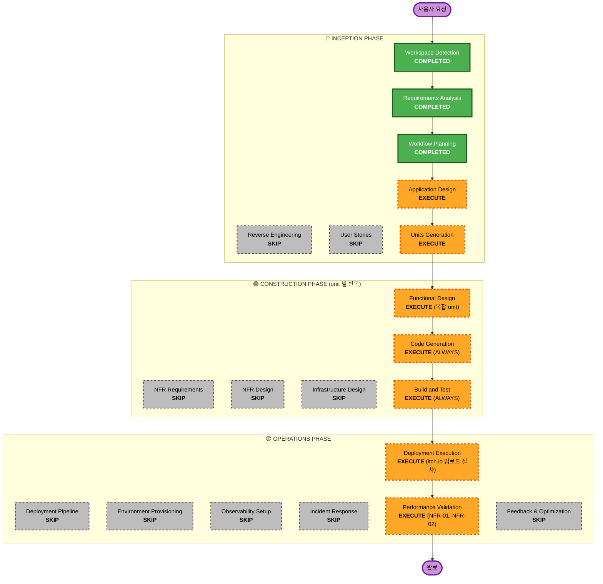

# 실행 계획 (Execution Plan)

**기준 문서**: `aidlc-docs/inception/requirements/requirements.md` (승인 완료)
**프로젝트**: 아공간 관리인 (Godot 4.7.2, 2D 탑뷰 정리 시뮬레이션, 웹 + 데스크톱 배포)

## 상세 분석 요약

### 변경 영향 평가 (Greenfield)
- **사용자에게 보이는 변경**: Yes - 아이템 목록, 선반 패널, 바닥 줍기, 무게 초과 메시지, 던전 연출, 상점 방문 연출, 게임오버
- **구조 변경**: Yes - Godot 오토로드 8개 (GameManager, DungeonManager, ItemManager, GoldManager, ExpManager, RequestManager, ShopManager, SaveManager) 와 씬 구조 신규
- **데이터 모델 변경**: Yes - ItemData (weight), ItemInstance, PlayerData, GameData (request_fail_count), FacilityData 신규
- **API 변경**: No (외부 API 없음. 내부 매니저 간 시그널 인터페이스만 존재)
- **NFR 영향**: Yes - 1280x720 고정, Compatibility 렌더러, 웹 빌드 (스레드 미사용), 저장 무결성, PBT 전면 적용

### 위험 평가
- **위험 수준**: Medium
  - 근거: 범위는 크지만 엔진과 기획이 확정되어 있고, 외부 시스템 연동이 없음. 미확인 가정 A-01~A-06 존재
- **롤백 복잡도**: Easy (Git 커밋 단위로 기능 단위 되돌림 가능)
- **테스트 복잡도**: Moderate (무게 · 골드 · 저장은 PBT로 검증 가능, 연출 · UI는 수동 확인 필요)

### 주요 위험 요소
1. **완료 판정 변경 (F2)**: 기획서 8.3과 다른 방식으로 확정됨. 설계 단계에서 `DungeonManager` 흐름을 먼저 고정해야 함
2. **상점 주기 (사용자 확정)**: 상점은 던전 1개 완료마다 열린다. 구매품은 다음 던전의 신규 아이템으로 입고되므로, 상점 → 구매품 적재 → 다음 던전 입고 흐름을 U2 · U4 에서 함께 다뤄야 함
3. **웹 빌드 제약**: Compatibility 렌더러 사용, 브라우저 저장 용량과 데이터 삭제 위험 (Q3 에서 내보내기 기능으로 보완)
4. **UI 조작 복잡도**: 목록, 선반 패널, 맵 드롭, 바닥 줍기가 같은 입력 체계를 공유함

## 확인 필요 (실행 전 확정)

| 번호 | 내용 | 현재 가정 |
| --- | --- | --- |
| P-01 | 대량 입고 상점 주기 | **확정 (사용자 답변)**: 던전 1개 완료마다 |
| P-02 | 구매품 공간 (D-18, A-07) 의 형태와 무게 한도 | 설계 단계 (Application Design) 에서 정함 |

## 워크플로우 시각화

## 실행할 Phase

### 🔵 INCEPTION PHASE
- [x] Workspace Detection (COMPLETED)
- [x] Reverse Engineering (SKIPPED)
  - **근거 (Rationale)**: Greenfield. 기존 소스 코드 없음
- [x] Requirements Analysis (COMPLETED)
- [x] User Stories (SKIPPED)
  - **근거 (Rationale)**: 단일 플레이어 게임이고 페르소나가 없음. 각 요구사항 (FR · NFR) 에 검증 기준이 이미 있음. 사용자 경험 변화는 FR-02~FR-07 에서 직접 다룸
- [x] Execution Plan (COMPLETED)
- [ ] Application Design - EXECUTE
  - **근거 (Rationale)**: 오토로드 8개, 씬 구조, 아이템 목록 · 선반 패널 · 바닥 상호작용 등 새 컴포넌트와 메서드 경계를 정해야 함. 특히 DungeonManager 흐름 (F2) 과 무게 계산 (FR-06~08) 의 책임 분리가 필요
- [ ] Units Generation - EXECUTE
  - **근거 (Rationale)**: 시스템이 여러 기능 단위로 나뉨. 아래 "잠정 Unit 구성" 참고. 단위별로 설계와 코드를 나눠야 구현 순서를 통제할 수 있음

### 🟢 CONSTRUCTION PHASE (unit 별 반복)
- [ ] Functional Design - EXECUTE (복잡한 unit 만)
  - **근거 (Rationale)**: 무게 적재 규칙, 던전 전투 흐름과 완료 판정, 긴급 요청 누적 실패, 상점 가중치 구매는 비즈니스 규칙이 많아 설계가 필요함. 단순 UI 전용 unit 은 SKIP
- [ ] NFR Requirements - SKIP
  - **근거 (Rationale)**: NFR-01~09 가 requirements.md 에 측정 기준과 함께 이미 정의됨
- [ ] NFR Design - SKIP
  - **근거 (Rationale)**: 별도 NFR 패턴 적용이 필요한 구조가 없음 (단일 클라이언트 게임)
- [ ] Infrastructure Design - SKIP
  - **근거 (Rationale)**: 서버, 클라우드, 데이터베이스가 없음. 배포는 정적 HTML5 zip (itch.io)
- [ ] Code Generation - EXECUTE (ALWAYS)
  - **근거 (Rationale)**: 모든 unit 의 구현 필요. unit 별 계획 승인 후 생성
- [ ] Build and Test - EXECUTE (ALWAYS)
  - **근거 (Rationale)**: Godot 헤드리스 테스트, PBT (NFR-09), 웹 빌드 검증 필요

### 🟡 OPERATIONS PHASE
- [ ] Deployment Pipeline - SKIP
  - **근거 (Rationale)**: CI 없이 Godot Export 후 itch.io 에 수동 업로드. 자동 파이프라인은 필요 없음
- [ ] Environment Provisioning - SKIP
  - **근거 (Rationale)**: 서버 환경이 없음. itch.io 는 외부 호스팅
- [ ] Deployment Execution - EXECUTE
  - **근거 (Rationale)**: 배포 대상 (itch.io HTML5 + 데스크톱 빌드) 이 확인됨. 업로드 절차와 체크리스트 작성 필요. 실제 업로드는 사용자가 직접 실행 (외부 게시이므로 AI 가 수행하지 않음)
- [ ] Observability Setup - SKIP
  - **근거 (Rationale)**: 운영 서버와 수집 지표가 없음
- [ ] Incident Response - SKIP
  - **근거 (Rationale)**: 운영 서비스가 없음
- [ ] Performance Validation - EXECUTE
  - **근거 (Rationale)**: NFR-01 (60 FPS) 과 NFR-02 (웹 로딩 · 입력 지연) 가 임시 기준이라 실제 기기 · 브라우저에서 검증 필요
- [ ] Feedback & Optimization - SKIP
  - **근거 (Rationale)**: 출시 후 운영 데이터가 아직 없음. 밸런스 조정은 플레이 테스트로 처리 (A-04)

## 잠정 Unit 구성 (Units Generation 에서 확정)

| 잠정 Unit | 범위 | 주요 요구사항 |
| --- | --- | --- |
| U1 창고 · 조작 | 플레이어 이동, 아이템 목록, 선반 패널, 맵 드롭, 바닥 줍기, 무게 적재 규칙 | FR-01~09, D-14, D-16 |
| U2 성장 · 경제 | EXP, 레벨업 증강, 공유 골드, 판매, 시설 구매 · 확장 | FR-10, FR-11, FR-19, FR-23, FR-24 |
| U3 던전 · 요청 | 던전 전투 흐름, 30초 수면 이벤트, 완료 판정, 미정리 누적, 긴급 요청, 누적 실패 게임오버 | FR-12~15, FR-20~22 |
| U4 상점 | 가중치 구매, 던전 완료마다 방문 연출, 대량 상자 구매품, 구매품 공간 (D-18) | FR-16~18 |
| U5 저장 · 플랫폼 | 자동 저장, 웹 내보내기/불러오기, 해상도, 한국어 UI, 웹 빌드 설정 | FR-25~29, NFR-03, NFR-06~08 |

**의존 순서 (잠정)**: U1 → U2 → U3 → U4 → U5. U3 는 U1 (아이템 상태), U2 (골드) 에 의존하고, U4 는 U3 의 던전 완료 신호에 의존함.

## 예상 일정
- **전체 Phase 수**: 6 (Workspace Detection, Requirements Analysis, Workflow Planning 완료 · Application Design, Units Generation 실행 예정)
- **실행 stage 수**: Application Design, Units Generation, Functional Design (복잡 unit), Code Generation (unit 별), Build and Test, Deployment Execution, Performance Validation
- **예상 소요 기간**: 미정 (기능 단위 구현 시간은 Units Generation 후 추정)

## 성공 기준
- **주 목표**: 튜토리얼 (아이템 10개) 과 던전 1~3 을 플레이하고, 던전 완료 · 상점 · 게임오버 흐름이 설계대로 동작
- **핵심 결과물**: Godot 프로젝트, 데스크톱 빌드, 웹 빌드 (itch.io zip), 테스트 결과
- **품질 게이트**: 
  - 기능 요구사항 FR-01~29 의 검증 기준 충족
  - PBT (무게 계산, 증강 중복 제한, 골드 계산, 저장 왕복) 통과
  - 저장 10회 왕복 후 아이템 수와 상태 동일 (NFR-03)
  - 웹 빌드가 itch.io 에서 실행됨 (NFR-06)

## 패키지 변경 순서 (Brownfield 전용)
- 해당 없음 (Greenfield)
